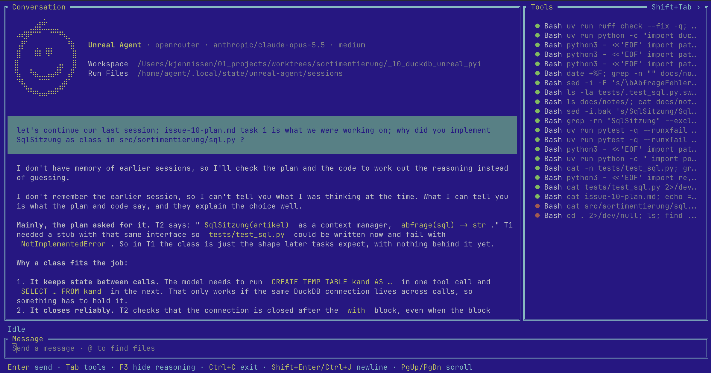

# Add Textual TUI with live tool-call panel

## Goal

Add an interactive terminal UI (TUI) for the agent in `src/agents_from_scratch/agent.py`, replacing the plain `input()` / `print()` loop for interactive use.

Reference: a screenshot of the target look (see above).

## Desired layout

- **Conversation panel** (left, ~75% width): scrollable history of user messages and agent answers, shown above the input.
- **Tools panel** (right, ~25% width): one line per tool call (`Bash <command…>`, truncated), added live while the agent runs.
- **Status line** (e.g. `Idle` / `Running…`) above the input.
- **Message input** at the bottom.
- **Footer** with key hints.

## What we like most

1. Tool calls and their status are visible at a glance via colour (running / success / failure).
2. *(Nice to have)* Tool calls can be clicked/selected to show their full command and output.

## Acceptance criteria

- [ ] `uv run` entry point (e.g. `agents-tui`) starts the TUI; existing CLI (`-p`, `--max-turns`) keeps working unchanged.
- [ ] Layout: Conversation (left), Tools (right), status line, message input at the bottom, footer with key hints.
- [ ] Submitting a message (Enter) appends it to the Conversation and starts the agent without freezing the UI.
- [ ] Every `<bash>` tool call appears in the Tools panel as soon as it starts, with a "running" colour.
- [ ] When a tool call finishes, its colour changes to success (exit code 0) or failure (non-zero).
- [ ] The agent's final answer (`<exit>` text) is appended to the Conversation; the status line returns to `Idle`.
- [ ] Conversation history (`messages`) persists across prompts within a session, like the current interactive mode.
- [ ] Conversation panel auto-scrolls to the newest content; PgUp/PgDn scroll it.
- [ ] Ctrl+C exits cleanly.

## Out of scope (for now)

- Clicking/selecting a tool call to view its full output (nice to have, follow-up).
- Token streaming (the agent uses `stream=False`; the answer appears at once).
- Cancelling a running agent turn.
- `@` file picker, hide-reasoning toggle, collapsing the Tools panel, ASCII logo, theming.

## Implementation notes

- **Library:** [Textual](https://textual.textualize.io/) (brings `rich`). Add as a dependency. `textual-dev` is optional for dev.
- **Event hooks in `run_agent`:** `run_agent` currently uses `print()`, which would corrupt a TUI. Add an optional callback (e.g. `on_event`) and emit `turn_start`, `assistant_message`, `tool_start(command)`, `tool_end(command, exit_code, output)`, `final(answer)`. The CLI path passes a callback that keeps today's prints, so its behaviour is unchanged.
- **Threading:** `run_agent` is synchronous (`httpx2.post`, `subprocess.run`). Run it in a Textual `@work(thread=True)` worker and post events to widgets via `app.call_from_thread(...)`. No async rewrite needed.
- **Widgets:** `VerticalScroll` + `Markdown`/`Static` for the conversation, `VerticalScroll` of `Static`s (Rich markup `[green]●[/]`) for tools, `TextArea` or `Input` for the message box, `Footer` + `BINDINGS` for key hints.
- **State:** the app holds the `messages` list between prompts (same as `main()` does today).
- Store each tool call's output in the `tool_end` event, so the click-to-inspect follow-up needs no agent changes.

## Estimate

~1–2 hours for the callback refactor plus a `tui.py` with the layout above.
